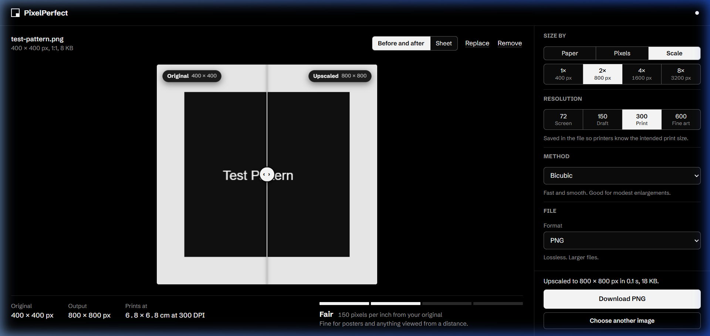
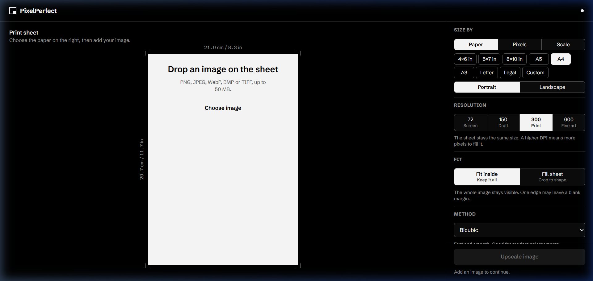
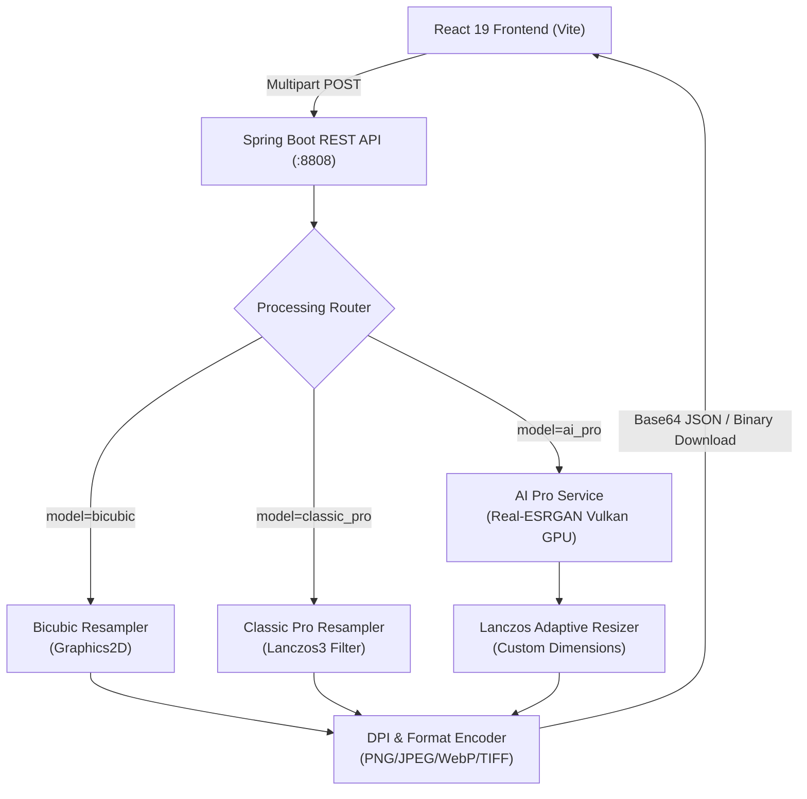

# 🖼️ PixelPerfect · Advanced Image Upscaler & Print Tool

[](https://openjdk.org/projects/jdk/21/)
[](https://spring.io/projects/spring-boot)
[](https://react.dev/)
[](https://vitejs.dev/)
[](https://github.com/xinntao/Real-ESRGAN)
[](LICENSE)

**PixelPerfect** is a high-performance, full-stack image upscaling and print preparation suite. It combines deterministic mathematical resampling (**Bicubic**, **Lanczos3 Classic Pro**) with GPU-accelerated deep learning super-resolution (**Real-ESRGAN AI Pro**), paired with physical print dimension calculations and embedded DPI metadata.

---

## 📸 Interface Preview

<div align="center">
  
  <p><em>Interactive before-and-after slider with live resolution badges, print density meter, and instant download</em></p>
</div>

<br/>

<div align="center">
  
  <p><em>Interactive print sheet canvas with ISO / US paper presets, target DPI configuration, and lightweight controls</em></p>
</div>

---

## 🌟 Key Capabilities

### 🧠 1. Multi-Tier Upscaling Engines
- **AI Pro (Real-ESRGAN NCNN Vulkan)**:
  - Deep convolutional super-resolution running locally via Vulkan on NVIDIA / AMD / Intel GPUs.
  - Native multi-scale AI engine (**2×, 3×, 4×**) dynamically selected based on image size to respect memory limits.
  - **Quick Resolution Presets**: 1-click scaling to **Full HD (1080p)**, **4K UHD (2160p)**, and **8K UHD (4320p)**.
  - Hybrid pipeline: Native AI super-resolution followed by high-precision Lanczos resampling to hit arbitrary custom dimensions without aspect-ratio distortion.
- **Classic Pro (Lanczos3 Resampler)**:
  - Pure mathematical windowed-sinc interpolation with ringing suppression.
  - Preserves edge acuity and textures without synthetic generative artifacts.
- **Bicubic Standard**:
  - Fast, resource-friendly bicubic interpolation with optional micro-sharpening.

### 📐 2. Precision Print Size Calculator
- **Standard Presets**: ISO A-Series (A3, A4, A5), US Formats (Letter, Legal), and Custom dimensions (cm / inches).
- **Orientation Toggle**: Instant portrait (↕) and landscape (↔) switching.
- **Physical DPI Tagging**: Select 72, 96, 150, 300 (Standard Print), or 600 DPI.
- **Embedded Metadata**: Output files contain native print headers (`pHYs` chunk for PNG, `app0JFIF` density tag for JPEG).

### 🛡️ 3. Enterprise Safety & Resilience
- **Strict Resolution Caps**: Hard limits ($8192 \times 8192$ px) protect against memory exhaustion attacks (Decompression Bomb / Pixel Flood).
- **Concurrency Control**: Bounded Semaphore-based job queue protects Tomcat thread pools from VRAM and heap spikes.
- **Exception Sanitization**: Engine crashes and stack traces are logged server-side via SLF4J, while clients receive safe, friendly error messages.

---

## 🏗️ System Architecture



---

## 💻 Tech Stack

| Layer | Technology | Details |
| :--- | :--- | :--- |
| **Frontend** | React 19, Vite 8, Vanilla CSS | Pure CSS tokens, zero utility bloat, high-contrast dark theme |
| **Backend** | Java 21, Spring Boot 3.5 | Virtual-thread friendly, Tomcat bounded thread pool |
| **AI Inference** | Real-ESRGAN NCNN Vulkan | Hardware-accelerated Vulkan binary (`realesrgan-x4plus`) |
| **Image I/O** | TwelveMonkeys ImageIO, Sejda WebP | Lossless PNG, JPEG, WebP, BMP, and TIFF support |
| **Testing** | JUnit 5, Mockito, Vitest, Testing Library | 78 backend tests + 41 frontend tests |

---

## 📡 REST API Reference

### 1. Upscale Image (JSON Preview)
`POST /api/images/upscale`

**Form Data Parameters:**
| Parameter | Type | Required | Description |
| :--- | :--- | :--- | :--- |
| `file` | `File` | Yes | Input image (JPEG, PNG, WebP, BMP, TIFF) up to 50MB |
| `model` | `String` | No | `bicubic`, `classic_pro`, or `ai_pro` (default: `standard`) |
| `scaleFactor` | `Integer` | No | Multiplier: `1` to `8` (default: `2`) |
| `targetWidth` | `Integer` | No | Target width in pixels (`16` to `8192`) |
| `targetHeight` | `Integer` | No | Target height in pixels (`16` to `8192`) |
| `outputFormat` | `String` | No | `PNG`, `JPEG`, `WEBP`, `BMP`, `TIFF` (default: `PNG`) |
| `dpi` | `Integer` | No | Target DPI: `72` to `1200` (default: `300`) |
| `quality` | `Integer` | No | Compression quality for JPEG/WebP: `1` to `100` (default: `90`) |
| `maintainAspectRatio` | `Boolean` | No | `true` or `false` (default: `true`) |

**Sample Response:**
```json
{
  "originalFilename": "photo.jpg",
  "originalWidth": 1920,
  "originalHeight": 1080,
  "targetWidth": 3840,
  "targetHeight": 2160,
  "scaleFactor": 2,
  "outputFormat": "PNG",
  "dpi": 300,
  "processingDurationMs": 3412,
  "model": "ai_pro",
  "dataUrl": "data:image/png;base64,iVBORw0KGgo...",
  "message": "AI upscaled image from 1920x1080 to 3840x2160 (PNG, 300 DPI)"
}
```

### 2. Direct Binary Download
`POST /api/images/download`
- Accepts identical multipart form parameters as `/upscale`.
- Streams binary attachment with correct MIME type and `Content-Disposition: attachment`.

### 3. Print Dimension Calculator
`GET /api/images/print-sizes?preset=A4&orientation=PORTRAIT&dpi=300`
- Returns exact computed pixel dimensions for physical print sizing.

---

## ⚙️ Configuration

Set these environment variables or configure `backend/src/main/resources/application.properties`:

| Property | Environment Variable | Default | Description |
| :--- | :--- | :--- | :--- |
| `server.port` | `SERVER_PORT` | `8808` | Backend HTTP port |
| `upscaler.image.max-width` | — | `8192` | Maximum width limit in pixels |
| `upscaler.image.max-height` | — | `8192` | Maximum height limit in pixels |
| `upscaler.concurrency.max-concurrent-jobs` | — | `3` | Max concurrent processing threads |
| `upscaler.ai.enabled` | `UPSCALER_AI_ENABLED` | `false` | Enable/disable Real-ESRGAN AI Pro |
| `upscaler.ai.executable` | `UPSCALER_AI_EXECUTABLE` | — | Absolute path to Vulkan executable |
| `upscaler.ai.model-dir` | `UPSCALER_AI_MODEL_DIR` | — | Path to Real-ESRGAN models folder |
| `upscaler.ai.gpu-id` | `UPSCALER_AI_GPU_ID` | `1` | GPU device ID (0, 1, or auto) |
| `upscaler.ai.tile-size` | `UPSCALER_AI_TILE_SIZE` | `128` | Tile size for VRAM allocation (0=auto) |
| `upscaler.ai.timeout-seconds` | `UPSCALER_AI_TIMEOUT_SECONDS` | `180` | AI engine timeout before kill |

---

## 🚀 Quick Start Guide

### Prerequisites
- **Java 21 JDK** (Eclipse Temurin recommended)
- **Node.js 20+** & **npm**
- **Maven 3.9+** (or bundled `mvnw`)
- *(Optional for AI Pro)*: Vulkan-compatible GPU & drivers

### 1. Run the Backend
```bash
# Navigate to backend directory
cd backend

# (Optional: Enable local AI Pro on Windows PowerShell)
$env:UPSCALER_AI_ENABLED = "true"
$env:UPSCALER_AI_EXECUTABLE = "C:\image-upscaler\ai-engine-v025\realesrgan-ncnn-vulkan.exe"
$env:UPSCALER_AI_MODEL_DIR = "C:\image-upscaler\ai-engine-v025\models"
$env:UPSCALER_AI_GPU_ID = "1"

# Launch Spring Boot
mvn spring-boot:run
```
The backend starts at `http://localhost:8808`. Check status: `http://localhost:8808/actuator/health`.

### 2. Run the Frontend
```bash
# Open a new terminal in the frontend directory
cd frontend

# Install dependencies
npm install

# Start Vite development server
npm run dev
```
The frontend is available at `http://localhost:5173`.

---

## 🧪 Running Tests

### Backend Unit & Integration Tests (78 tests)
```bash
cd backend
mvn clean test
```
*Validates Lanczos resampling math, boundary conditions, concurrency semaphores, format codecs, and mocked AI Pro pipelines.*

### Frontend Vitest Suite (41 tests)
```bash
cd frontend
npm test -- --run
```
*Validates UI controls, preset switching, aspect-ratio preservation, and responsive layout behavior.*

---

## 📄 License

This project is licensed under the [MIT License](LICENSE).
Real-ESRGAN is licensed under the BSD 3-Clause License.
